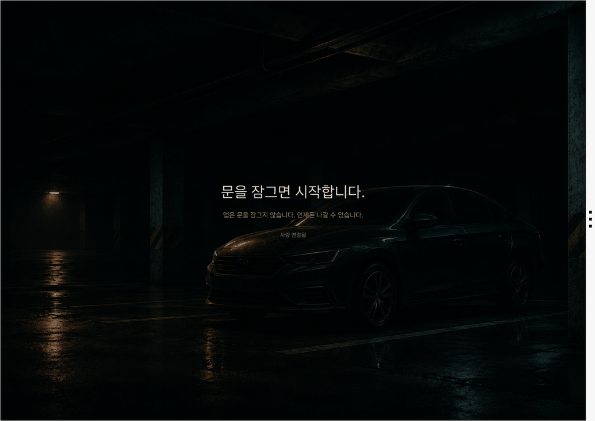
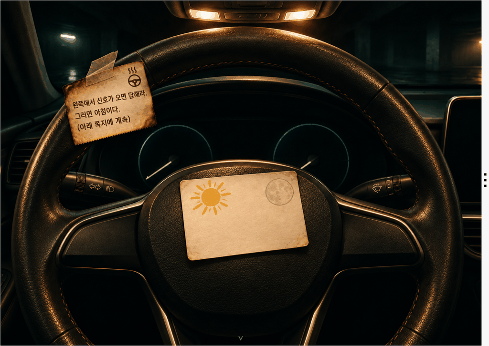
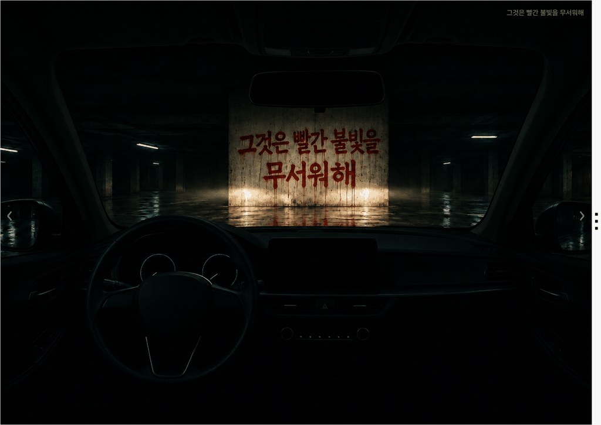
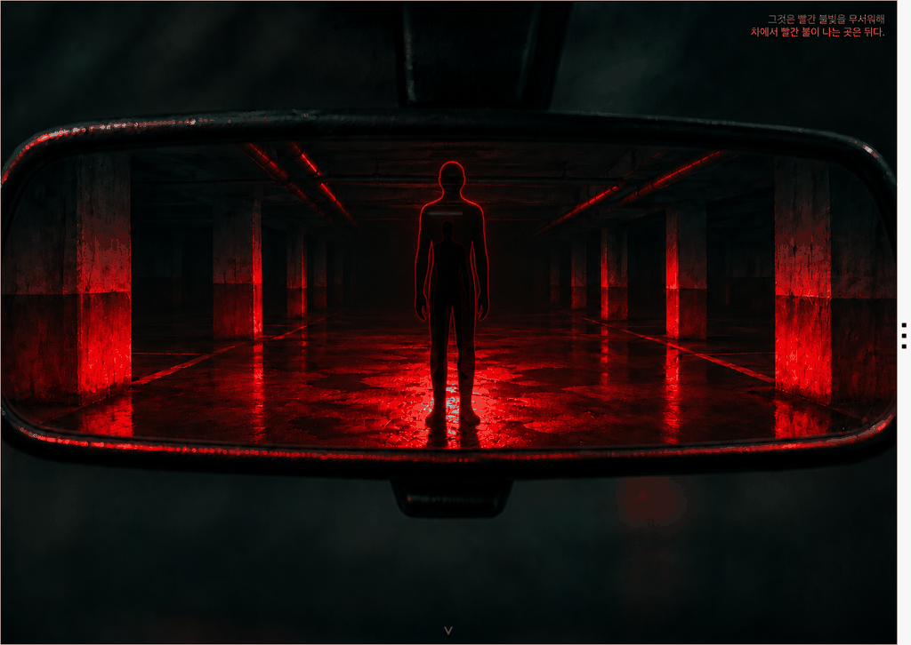
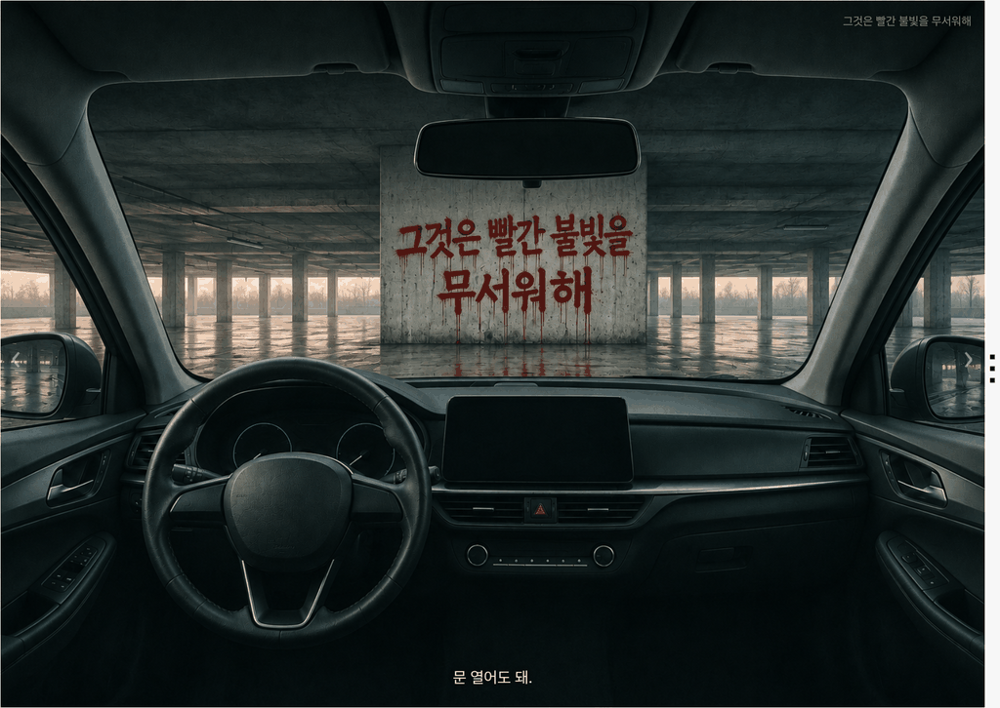
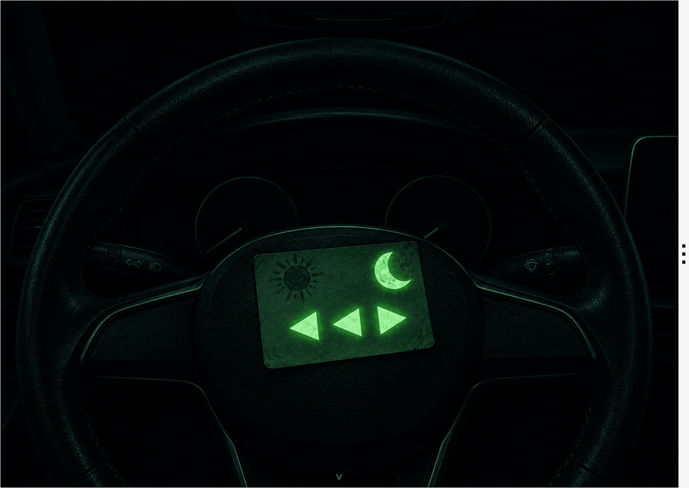
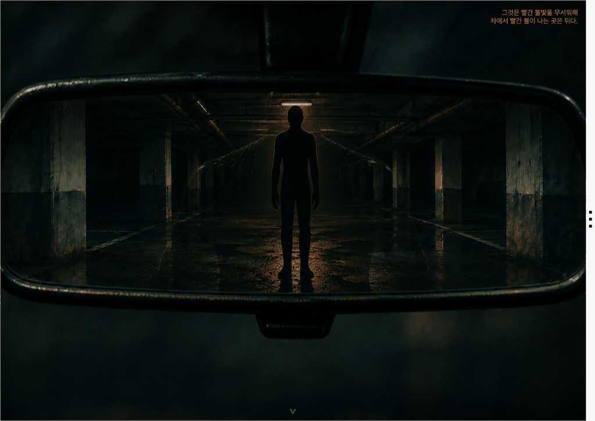
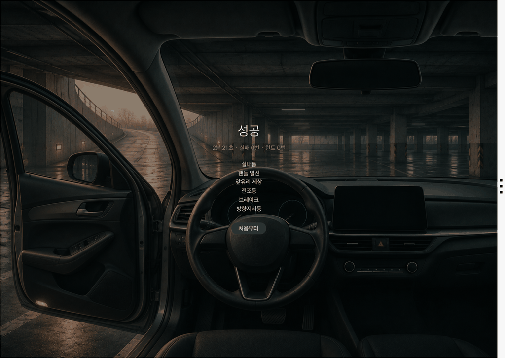
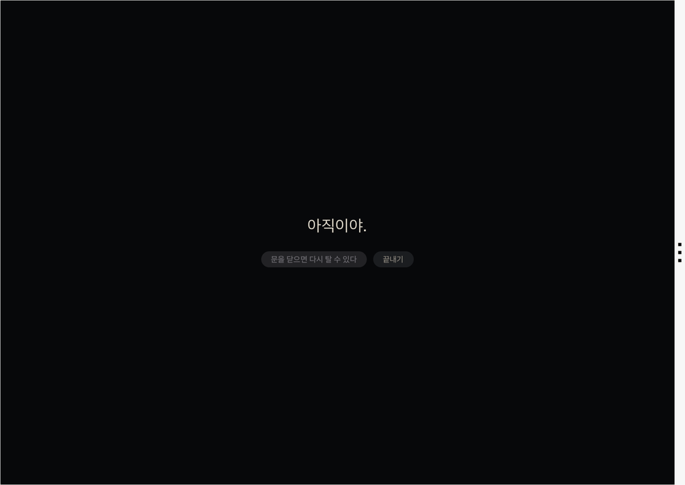
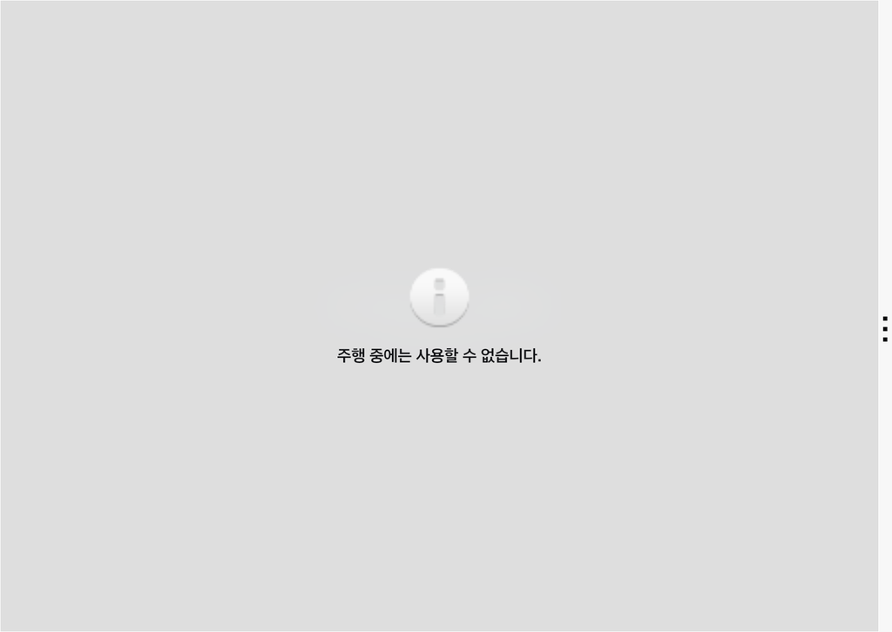

# 오너테스트 (OwnerTest) — 앱 프로젝트 소개

<!-- 접수양식 02 파트 원문. tools/build-proposal-docx.py가 "## N." 절을 양식의 N번 칸에 넣는다. 실명·연락처·계정 정보를 쓰지 않는다. 기준 문서: docs/scenario-script.md(v1.2), docs/signal-mapping.md. PRD.md(v0.6)는 구판이라 쓰지 않는다. -->

## 1. 앱 한 줄 소개

어두운 지하주차장에 갇힌 차 안에서, **진짜 차의 실내등·핸들 열선·앞유리 제상·전조등·브레이크·방향지시등을 직접 조작해** 하룻밤을 버티는 정차 전용 탈출 게임 — "설명서 대신, 테스트로" 내 차의 기능을 15분 만에 손으로 익힌다.

## 2. 기획 배경

### 불편한 순간: 필요한 기능을 필요한 순간에 못 찾을 때

새 차를 받으면 출고 설명을 듣지만, 기억에 남는 건 시동 버튼 정도다. 겨울 아침 앞유리에 김이 서려도 제상 버튼이 어느 것인지 헤매고, 핸들 열선이 있는 줄도 모른 채 한 철을 보낸다. 렌터카·카셰어링처럼 처음 타는 차에서는 전조등 스위치와 방향지시등 레버부터 다시 찾아야 한다. 답은 글로브박스 속 설명서에 있지만, 수백 쪽짜리 책을 펴는 사람은 드물다.

### 숫자로 본 문제

- **설명서는 잘 읽히지 않는다.** 미국 운전자 2,000명 조사에서 15%는 자기 차 설명서 내용을 "전혀 모른다"고 답했고, 낯선 경고등이 켜졌을 때 설명서를 먼저 찾아보겠다는 사람은 43%에 그쳤다. (Talker Research·LIQUI MOLY, 2024-10)
- **차의 표시를 알아보지 못한다.** 같은 조사에서 브레이크 시스템 경고등을 맞힌 사람은 16%, 타이어 공기압 경고등은 47%였다. (같은 조사)
- **기능은 계속 늘어난다.** 차량용 OS와 OTA로 출고 뒤에도 기능이 추가되지만, 운전자가 차를 배우는 시간은 출고 날 설명에서 멈춘다.

### 왜 해결이 필요한가

읽은 것은 잊어도 손으로 해 본 것은 남는다. 그런데 지금까지 "차 기능 배우기"는 글(설명서)이나 말(출고 설명)로만 이루어졌다. 차 안에 앉아 있는 정차 시간에, 실제 스위치를 눌러야만 앞으로 나아가는 이야기를 주면 **배우는 줄도 모르고 조작을 익힌다**. 차량 앱만 실제 스위치 조작을 알 수 있으므로, 이 경험은 차량 앱으로만 만들 수 있다.

출처
- Talker Research(LIQUI MOLY 의뢰, 미국 운전자 2,000명, 2024-09-23~27 조사, 2024-10-18 발표): https://talkerresearch.com/many-americans-would-fail-their-drivers-test-if-taken-today/

## 3. 앱 주요 기능 및 차량 특화 요소

### 핵심 기능

| ID | 기능 | 해결하는 문제 |
|---|---|---|
| F1 | **실제 조작이 열쇠인 퍼즐** — 실내등을 켜야 핸들에 붙은 쪽지가 보이고, 핸들 열선을 켜야 감열지에 글씨가 드러나고, 제상과 전조등을 함께 켜야 앞유리 너머 기둥의 글씨가 읽힌다 | 기능을 "읽는" 대신 "찾아서 누른다". 조작 6개를 15분 안에 몸으로 익힘 |
| F2 | **화면 속 차가 실제 차를 따라간다** — 1인칭 차 안 화면(정면·좌우·핸들·룸미러·사이드미러 7개 시점)이 실제 차량 신호에 따라 바뀐다. 실내등을 켜면 화면 속 차 안도 밝아지고, 방향지시등을 켜면 화면 속 레버도 깜빡인다 | 화면 속 조작이 아니라 진짜 스위치를 찾게 만든다 |
| F3 | **긴장 이벤트 2개** — 시간이 지나면 뒤에서 "그것"이 다가오고(브레이크를 8초 밟아 붉은 브레이크등으로 쫓는다), 마지막에는 왼쪽 경사로에서 손전등 신호가 온다(방향지시등 ◀ ◀ ▶ 로 답한다) | 단순 퀴즈가 아니라 게임으로서의 재미와 반복 조작 |
| F4 | **차의 첫 목소리(결말)** — 신호에 답하면 새벽이 오고, 처음으로 차가 말한다. "문은 내가 잠갔어. 오늘 밤은 연습이었어." 문을 열면 결과 화면 | 이야기의 반전: 나를 가둔 건 나를 훈련시키려던 내 차 |
| F5 | **상황 힌트** — 진전이 없으면 화면 아래에 한 줄(상황 묘사 → 마지막 단계에서만 조작 이름). 실패해도 본 단서는 그대로 두고 이어서 다시 | 막혀서 그만두는 일 방지 |
| F6 | **결과** — 걸린 시간, 실패·힌트 횟수, 배운 조작 6개 | 다시 도전, 배운 것 확인 |

### 왜 폰 앱이 아니라 차량 앱인가 (차량 특화 요소)

- **열쇠가 진짜 스위치다.** 폰 탈출 게임은 화면 안에서 끝난다. 오너테스트의 김은 진짜 제상 버튼으로만 걷히고, 쪽지 글씨는 진짜 핸들 열선을 켜야만 드러난다. Vehicle SDK가 그 순간을 읽기 때문에 가능하다.
- **시작과 끝도 손으로 한다.** 시작 버튼 대신 실제 문 잠금으로 시작하고, 결말에서는 실제로 문을 열어 나간다.
- **차 스피커가 차의 목소리가 된다.** 결말의 목소리는 Pleos TTS로 차량 스피커에서 나온다.
- **정차 맥락에만 산다.** 주행 중 사용을 선언하지 않아(DO 미선언) 주행 중에는 플랫폼이 앱을 막고, 앱도 기어가 P를 벗어나면 멈춘다. 차 안에서 기다리는 시간(충전·대기·출발 전)을 쓴다.

### 차량에서의 새로운 경험

운전자는 주차된 차에 앉아 문을 잠근다. 화면이 바뀌고, 어두운 지하주차장의 차 안에서 깨어난다. 화면 속 핸들에 무언가 붙어 있지만 어두워서 보이지 않는다 — 플레이어는 머리 위의 진짜 실내등을 찾아 켠다. 15분 뒤 문을 열고 나올 때, 실내등·핸들 열선·제상·전조등·브레이크등·방향지시등은 "설명서에서 본 기능"이 아니라 "직접 눌러 본 스위치"가 되어 있다.

### 기존 서비스와의 차이

| 서비스 | 하는 일 | 오너테스트와의 차이 |
|---|---|---|
| 차량 설명서·웹 매뉴얼 | 기능 설명 열람 | 읽기. 오너테스트는 실제 조작을 해야 이야기가 나아간다 |
| 출고 시 기능 설명 | 1회성 설명 | 듣기. 오너테스트는 혼자서, 원할 때, 다시 할 수 있다 |
| 폰 탈출·공포 게임 | 화면 속 방을 조사 | 방이 **내 차**이고 열쇠가 **진짜 스위치**다. 화면 밖으로 손이 나가야 한다 |
| 차량 퀴즈·교육 콘텐츠 | 문제와 정답 | 정답을 "아는 것"과 "스위치를 찾아 누르는 것"은 다르다 |

## 4. 주요 사용 시나리오

**페르소나** — 디 올 뉴 아반떼를 출고한 지 3일 된 20대 첫 차 오너. 퇴근 후 아파트 지하주차장에 차를 세웠고, 15분이 비었다. 핸들 열선과 제상 버튼이 어디 있는지 아직 모른다.

**장면 1. 시작 (정차, 기어 P)**
1. 앱을 열면 검은 화면에 한 줄: "문을 잠그면 시작합니다." 아래 작게 "앱은 문을 잠그지 않습니다 / 언제든 나갈 수 있습니다."
2. 실제 도어 잠금 버튼을 누르자 화면이 어두운 차 안 1인칭 화면으로 바뀐다.

**장면 2. 조사 (실내등 → 핸들 열선 / 실내등 10초 → 끄기)**
3. 화면 속 핸들을 누르면 "어두워서 보이지 않는다." 머리 위의 진짜 실내등을 켜자 핸들의 감열지와 야광 쪽지가 보인다.
4. 감열지 구석의 열 표시를 보고 핸들 열선 버튼을 찾아 켠다. 글씨가 드러난다: "왼쪽에서 신호가 오면 답해라. 그러면 아침이다."
5. 실내등을 10초 켰다가 끄자 어둠 속에서 야광 쪽지가 빛난다: ◀ ◀ ▶

**장면 3. 앞유리 (제상 + 전조등)**
6. 앞유리가 뿌옇다. 제상을 켜 김을 걷고 전조등을 켜자 기둥에 스프레이 글씨: "그것은 빨간 불빛을 무서워해"

**장면 4. 뒤에서 다가오는 것 (브레이크)**
7. 룸미러에 큰 윤곽이 다가온다. 기둥의 글씨를 떠올리고 브레이크를 밟자 뒤가 붉게 물들고, 8초를 버티자 윤곽이 사라진다. 25초 안에 쫓지 못하면 실패하지만, 본 단서는 그대로 두고 이어서 다시 할 수 있다.

**장면 5. 신호와 결말 (방향지시등 → 문 열기)**
8. 왼쪽 사이드미러 속 경사로에서 손전등이 세 번 깜빡인다. 방향지시등을 왼쪽·왼쪽·오른쪽으로 켜서 답한다.
9. 새벽이 오고, 처음으로 차가 말한다. "문은 내가 잠갔어. 오늘 밤은 연습이었어. 밖은 진짜야. 살아남아. 문 열어도 돼." 실제로 문을 열면 결과 화면에 배운 조작 6개가 정리된다.

- 결말 전에 문을 열면 벌 없이 "아직이야."와 함께 [다시 타기]·[끝내기]를 고른다. 기어가 P를 벗어나면 게임이 멈추고, 주행 중에는 플랫폼이 앱 화면을 막는다.

## 5. 개발 계획

### 구조

차량 앱 하나로 동작한다. 서버·계정이 없다. 차량 신호를 읽기 전용으로 받아 게임 엔진에 넣고, 엔진 상태에 맞는 장면 이미지를 골라 보여 준다.

| 구성 | 역할 |
|---|---|
| 차량 신호 모듈(`signals/`) | Vehicle SDK 리스너 + 초기 조회로 실내등·핸들 열선·제상·전조등·브레이크·방향지시등·문 잠금/열림·기어를 하나의 상태로 모은다. 읽기 전용 |
| 게임 엔진(`game/`) | 시나리오 상태기계. Android 의존이 없는 순수 Kotlin이라 가짜 신호로 전 과정을 단위 테스트(16개)한다 |
| 화면(`ui/`) | 상황별 생성 이미지 46장을 엔진 상태에 맞춰 겹치고 크로스페이드. 방향지시등 화살표·힌트·자막은 코드로 얹는다 |
| 음성(`voice/`) | 결말·조기 탈출의 차 목소리. Pleos TTS 기기 내 모드 |

### SDK/API 사용 계획

| 기능 | 용도 | SDK·API | 검증 상태(에뮬레이터 2.1.0) |
|---|---|---|---|
| 시작·결말 | 문 잠금·문 열림 | Vehicle SDK `Door` 잠금·열림 리스너 | 수신 확인 |
| F1 | 실내등(핸들 조사·야광 쪽지 충전) | Vehicle SDK `Light` 실내등 리스너 | 수신 확인 |
| F1 | 핸들 열선(감열지) | Vehicle SDK `SteeringWheel` 열선 상태 리스너 | 수신 확인(11-09 앱 실측) |
| F1 | 앞유리 제상(기둥) | Vehicle SDK `HVAC` 앞유리 제상 리스너 | 수신 확인 |
| F1 | 전조등(기둥) | Vehicle SDK `Light` 하향등·상향등 리스너 | 수신 확인 |
| F3 | 브레이크(뒤의 것 격퇴) | Vehicle SDK `Brake` 페달 상태 리스너 | 수신 확인 |
| F3 | 방향지시등(신호 응답 ◀ ◀ ▶) | Vehicle SDK `TurnSignal` 리스너 | 왼쪽·끔·왼쪽·끔·오른쪽·끔 모두 수신 확인(11-09) |
| 규칙 | 기어 P 이탈 시 정지 | Vehicle SDK `Gear` 리스너 | 수신 확인 |
| F4 | 차의 목소리 | Pleos TTS SDK 3.3.1 기기 내 모드(ko_KR) | 음성 재생 확인 |
| 권한 | 조회 퍼미션 4개와 음성 퍼미션 1개 | `pleos.car.permission.` `CAR_LIGHTS`·`CAR_CLIMATE`·`CAR_DRIVE`·`CAR_DOORS`·`TTS_SERVICE` | 확인 |

에뮬레이터에서 신호 24단계 실측과 전 과정 자동 실행(시작 → 조사 → 격퇴 → 신호 응답 → 결말 → 문 열어 종료, 분기 3개)을 통과했다. 기록은 저장소 `docs/measurements/`.

### 판정 규칙

| 규칙 | 기준(초기값) |
|---|---|
| 시작 | 도어 잠금 false → true. 이미 잠긴 채 앱을 열었다면 한 번 풀었다가 다시 잠가야 시작한다(이때의 화면 안내 문구는 아직 없어 2차 PT까지 넣는다) |
| 상태 판정 | 실제 신호가 들어오면 바로 반영한다. 시작할 때 이미 켜져 있던 것은 막지 않는다(그 단계가 바로 풀림) |
| 감열지 | 핸들 열선 1단 이상을 켜면 10초에 걸쳐 글씨가 드러난다. 읽으려면 실내등이 켜져 있어야 한다 |
| 야광 쪽지 | 실내등 10초 이상 연속 켬 → 끔. 30초 동안 보이고 다시 충전 가능 |
| 기둥 | 앞유리 제상을 켜고 10초 뒤 김이 걷힌 상태에서 전조등 ON(상향 포함) |
| 뒤의 것 | 시작 후 90초 + 0~60초 무작위로 등장. 브레이크 8초 연속 유지로 격퇴(떼면 처음부터). 25초 안에 브레이크가 없으면 실패 → 본 단서는 유지한 채 다시 |
| 신호 | 감열지·야광 쪽지·기둥·격퇴 1회를 모두 마친 뒤 20~60초 후. 방향지시등 왼쪽 → 끔 → 왼쪽 → 끔 → 오른쪽을 켜는 순간 클리어. 틀리거나 40초 안에 답이 없으면 30~90초 뒤 다시 |
| 조기 탈출 | 결말 전 문 열림 → "아직이야." + [다시 타기](진행 유지)·[끝내기] |
| 일시정지 | 기어 ≠ P → 게임을 멈춘다(주행 중에는 플랫폼이 화면도 막는다). P로 돌아오면 이어서 |

### 개발 범위와 일정

| 기간 | 범위 |
|---|---|
| ~11/9 (완료) | 신호 계층, 게임 엔진 + 단위 테스트 16개, 장면 이미지 46장 화면, 결말 음성, 에뮬레이터 신호 실측·전 과정 자동 테스트, 전용 시연 콘솔 |
| ~11/15 (1차 제출) | 기획서, 시연 영상, 서명 APK |
| ~12/2 (2차 PT) | 효과음(긁는 소리·문 철컥·정적), 문이 잠긴 채 시작했을 때의 안내 문구, 실차 화면 크기에서 탭 자리·글씨 크기 조정, 조작 카드(설명서 문구) 검수, 핸들 열선이 없는 트림 대체 경로 |

### 개인정보와 안전

- **서버·계정·수집이 없다.** 진행 상태와 결과는 앱이 켜져 있는 동안만 메모리에 두고, 기기에도 저장하지 않는다. 위치·차대번호 등 식별 정보를 읽지 않는다.
- **앱은 차를 읽기만 한다.** 제어 API와 `CONTROL_*` 퍼미션을 쓰지 않는다. 문을 잠그는 것도 여는 것도 플레이어 손이다. 시작 화면에 "앱은 문을 잠그지 않습니다 / 언제든 나갈 수 있습니다"를 상시 안내하고, 결말 전에 문을 열어도 벌이 없다.
- **정차 전용.** DO를 선언하지 않아 주행 중에는 플랫폼이 앱을 막고, 앱도 기어가 P를 벗어나면 즉시 멈춘다.
- **공포 수위.** 사람이 다치는 장면·폭력·얼굴 묘사가 없다. 기둥의 글씨는 흘러내린 붉은 스프레이 페인트이고, "그것"은 어둠 속 윤곽뿐이며, 결말에서 모든 것이 차의 훈련이었다고 밝힌다.

## 6. 기대효과 및 발전 가능성

### 사용자에게 주는 가치

- 운전자: 겨울 아침의 제상, 어두운 주차장의 실내등, 추운 날의 핸들 열선, 뒤차에 보내는 브레이크등과 방향지시등을 **15분 안에 직접 눌러 본다.** 필요한 순간에 스위치를 바로 찾는다.
- 현대자동차그룹: 출고 설명에 기대던 "차 기능 알리기"를 플레이어가 스스로 하는 콘텐츠로 바꾼다. 새로 생긴 기능을 에피소드 하나로 알릴 수 있다.
- Pleos Connect: 실제 차량 조작이 곧 게임 입력이 되는, 차량 앱만 할 수 있는 게임 장르의 첫 사례가 된다.

### 타깃 고객

| 순위 | 타깃 | 접점 |
|---|---|---|
| 1차 | **신차 출고 고객**(출고 후 첫 1주) | 출고 안내·딜러 설명: "설명서 대신 15분" |
| 2차 | 렌터카·카셰어링·법인차 이용자(처음 타는 차) | 출발 전 주차장에서 짧은 플레이 |
| 3차 | 충전·대기 중인 운전자 | 정차 시간을 채우는 15분 게임 |

### 예상 MAU

| 항목 | 값 | 근거 |
|---|---|---|
| Pleos Connect 탑재 차종 국내 판매(2025) | 그랜저 71,775대 + 아반떼 79,335대 = 연 약 15만 대 | 현대자동차 2025년 판매 실적 |
| 월 출고 | 약 1만 2,500대 | 위 ÷ 12 |
| 출고 첫 달 플레이율 | 30% | 가정 |
| 누적 보유 차량의 월 재플레이(새 에피소드·동승자) | 3% | 가정 |
| **예상 MAU(2027년 말, 누적 약 23만 대)** | **약 1만 1천** | 신규 약 3,750 + 누적 약 6,900 |
| 장기 | Pleos Connect 2030년 글로벌 약 2,000만 대 목표 | 같은 비율이면 MAU 약 60만 |

### Retention

한 번 깨면 끝나는 탈출 게임은 재방문이 낮다. 그래서 한 편이 아니라 **시리즈**로 만든다.

- **에피소드마다 다른 조작.** 1편(지하주차장)은 실내등·열선·제상·전조등·브레이크·방향지시등. 다음 편은 창문·와이퍼·비상 상황, 겨울(시트 열선·뒷유리 열선), 충전(충전구·예약 충전) 등으로 차의 다른 기능을 다룬다.
- **계절과 OTA에 맞춘다.** 장마철·첫 한파 같은 시기에 맞는 편을 내고, OTA로 기능이 추가되면 그 기능을 쓰는 장면을 더한다.
- **기록에 도전한다.** 걸린 시간, 힌트 0회 클리어.
- **목표: 30일 Retention 25%.** 에피소드 2~3개 출시를 전제로 한 목표이며, 출시 후 실측으로 보정한다.

### 서비스 확대 계획

| 단계 | 내용 | 수익 |
|---|---|---|
| 1단계 | 1편 무료. 공모전 범위 | — |
| 2단계 | **출고 프로그램 연계**: 딜러 출고 설명을 보완하고, 렌터카·카셰어링의 처음 타는 차 안내로 제공 | 제조사·렌터카사 B2B |
| 3단계 | 차종별 화면(그랜저·아반떼 등)과 에피소드 확대, 공식 설명서 문구와 연결한 조작 카드 | 콘텐츠 |
| 4단계 | 선택 동의를 받은 익명 집계: "운전자가 가장 오래 찾는 스위치" → 설명서·실내 설계(HMI) 개선 근거 | 그룹 내 협업 |

출처
- 현대자동차 2025년 판매 실적: https://www.hyundaimotorgroup.com/ko/news/hyundai-motor-company-sales-4138180-units-2025
- Pleos Connect 2,000만 대 목표·첫 탑재(머니투데이, 2026-04-30): https://www.mt.co.kr/industry/2026/04/30/2026042916243666820

## 7. 참고자료

- GitHub 저장소: https://github.com/hoyeoni1/hyundaiapp-ownertest (소스 코드. release APK: 【제출 전 기입 — 서명 APK를 올린 뒤 apk/SamgakGorae_OwnerTest_release.apk 또는 GitHub Releases 주소】)
- 시연 영상: 【제출 전 기입 — 영상 링크 또는 첨부 파일명】
- 화면: 아래 화면은 앱을 Pleos Connect 에뮬레이터 2.1.0에서 실행해 찍은 것이다.

- 시연 데이터 안내: 에뮬레이터에는 실제 스위치가 없어 문 잠금·실내등·열선·제상·전조등·브레이크·방향지시등·기어 값을 에뮬레이터 콘솔로 주입했다(실차에서는 손으로 조작). 시연 영상은 "뒤의 것" 등장 시간을 줄인 시연용 타이머를 쓴다. 장면 이미지는 생성 이미지다.

## 8. 숏폼 링크

【제출 전 기입 — 숏폼 게시 링크】
